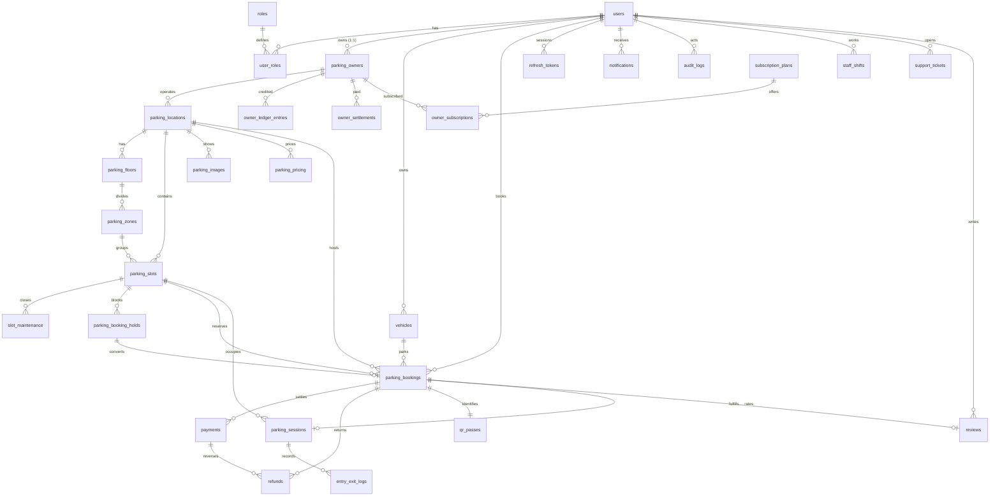

# SmartPark Pro — Entity-Relationship Diagram

Generated from `backend/src/main/resources/db/migration/V1–V6`. Money = BIGINT paise, time = timestamptz UTC.

## Key constraints

| Constraint | Purpose |
|---|---|
| `no_overlapping_holds` (gist exclusion, ACTIVE only) | Holds block inventory |
| `no_overlapping_bookings` (gist exclusion, CONFIRMED/CHECKED_IN) | Double-booking impossible |
| `uq_payments_booking_captured` | **Removed in V6** — top-ups need multiple CAPTURED rows |
| `payment_webhook_events.gateway_event_id UNIQUE` | Webhook replay safety |
| `qr_passes.token_hash UNIQUE` | Opaque token lookup |
| `parking_bookings.booking_reference UNIQUE` | Customer-facing id |
| `vehicles(user_id, vehicle_number) UNIQUE` | No duplicate plates per user |
| `chk_hold_expiry` | Holds always expire after creation |
